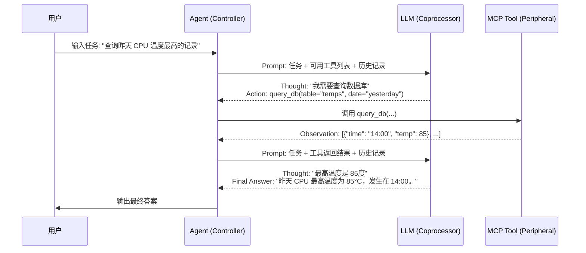

# 📄 2026 AI Agent 技术原理与全流程架构图解

**更新日期**：2026-10-10
**适用对象**：硬件/系统工程师，需从底层逻辑理解 AI 工作流。

## 1. 核心原理图：LLM 是如何“思考”的？

在 2026 年，我们不再关注 Transformer 的内部矩阵乘法，而是关注其**I/O 特性**。

```mermaid

graph TD
    Input[输入文本序列] --> Tokenizer[分词器 (Tokenizer)]
    Tokenizer --> Tokens[Token IDs: [101, 205, ...]]
    Tokens --> Embedding[嵌入层 (Embedding Layer)]
    Embedding --> Vectors[高维向量矩阵]
    Vectors --> Transformer[Transformer Blocks (Attention + FFN)]
    Transformer --> Logits[概率分布 logits]
    Logits --> Sampler[采样器 (Sampler)]
    Sampler --> NextToken[下一个 Token ID]
    NextToken --> Detokenizer[解词器]
    Detokenizer --> Output[输出文本]
    
    style Transformer fill:#f9f,stroke:#333,stroke-width:2px
    style Sampler fill:#ff9,stroke:#333,stroke-width:2px
```

**硬件映射解读：**
*   **Tokenizer**: 相当于 **ADC (模数转换)**，将自然语言转换为机器可处理的数字 ID。
*   **Transformer Blocks**: 相当于 **CPU 流水线**，进行并行计算。注意：它是**无状态**的，每次推理都是全新的开始，除非你传入历史上下文。
*   **Sampler**: 相当于 **DAC (数模转换) + 噪声注入**。根据概率分布选择一个 Token。`Temperature` 参数控制噪声大小（高温=高随机性/创造性，低温=高确定性/准确性）。
*   **Context Window**: 相当于 **SRAM 容量**。所有输入的 Token + 输出的 Token 总和不能超过这个限制，否则会发生“溢出”（遗忘最早的信息）。

---

## 2. 标准 Agent 执行流程图 (ReAct 模式)

这是最基础的 Agent 循环，类似于 CPU 的 **Fetch-Decode-Execute** 周期。



**关键概念：**
*   **Thought**: LLM 的内部推理过程（不直接输出给用户，用于调试）。
*   **Action**: LLM 决定调用的工具名称和参数（JSON 格式）。
*   **Observation**: 工具执行后的返回结果（作为新的上下文喂给 LLM）。
*   **Loop**: 如果 LLM 认为信息不足，会再次进入循环；如果认为足够，则输出 `Final Answer`。

---

## 3. 2026 主流架构：RAG + MCP + LangGraph 混合系统

这是你在实际工作中需要构建的系统架构。它结合了**检索增强 (RAG)**、**标准化连接 (MCP)** 和 **状态机编排 (LangGraph)**。

```mermaid
graph TB
    subgraph Client_Layer [用户交互层]
        UI[Streamlit UI / CLI]
    end

    subgraph Orchestration_Layer [编排控制层 (LangGraph)]
        Router{Router Node}
        Analyst[Analyst Agent]
        Verifier[Verifier Agent]
        Reporter[Reporter Agent]
        State[(Global State / SQLite)]
        
        Router -->|CPU Error| Analyst
        Router -->|Memory Leak| Verifier
        Analyst --> Reporter
        Verifier --> Reporter
    end

    subgraph Memory_Layer [记忆存储层]
        VectorDB[(Vector DB: Chroma)]
        History[(Chat History)]
    end

    subgraph Protocol_Layer [通信协议层 (MCP)]
        MCP_Client[MCP Client]
    end

    subgraph Tool_Layer [工具与服务层]
        MCP_Server_Logs[MCP Server: Logs]
        MCP_Server_DB[MCP Server: SQLite]
        Local_LLM[Ollama: Qwen2.5-14B]
        Cloud_LLM[Groq API: Llama-3.3]
    end

    UI --> Router
    Router --> State
    Analyst --> MCP_Client
    Verifier --> MCP_Client
    MCP_Client <-->|STDIO/SSE| MCP_Server_Logs
    MCP_Client <-->|STDIO/SSE| MCP_Server_DB
    
    Analyst --> Local_LLM
    Reporter --> Cloud_LLM
    
    MCP_Server_Logs --> VectorDB
    State --> History
```

**架构解读：**
1.  **Client Layer**: 你的 Streamlit 界面，负责接收输入和展示结果。
2.  **Orchestration Layer (LangGraph)**:
    *   **Router**: 根据用户意图分发任务（类似中断控制器）。
    *   **State**: 全局共享内存，保存所有中间结果。
3.  **Protocol Layer (MCP)**:
    *   **MCP Client**: 嵌入在 Agent 中，自动发现并调用下方的 MCP Servers。
    *   **优势**: 如果你要换数据源，只需更换 MCP Server，Agent 代码无需修改。
4.  **Tool Layer**:
    *   **Local LLM**: 处理敏感数据或简单逻辑，节省成本。
    *   **Cloud LLM**: 处理复杂推理或生成报告，利用云端算力。
    *   **MCP Servers**: 真正的“驱动程序”，连接你的 SQLite 日志库和向量数据库。

---

## 4. 数据流向详解 (从输入到输出)

假设用户问：“*为什么昨天下午系统崩溃了？*”

1.  **Input Processing**:
    *   用户输入被转化为 Vector Embedding。
    *   在 **Vector DB** 中检索相似的historical crash reports (RAG)。
2.  **State Initialization**:
    *   LangGraph 初始化 State: `{ "query": "...", "context": [retrieved_docs], "steps": [] }`.
3.  **Routing**:
    *   Router Node 判断这是“故障诊断”任务，路由到 `Diagnosis Agent`。
4.  **Reasoning & Action (Loop)**:
    *   **Step 1**: LLM 思考：“我需要查看昨天的系统日志。”
    *   **Action**: 调用 `MCP Tool: get_logs(date="yesterday", level="ERROR")`.
    *   **Observation**: MCP Server 返回 50 条错误日志。
    *   **Step 2**: LLM 思考：“日志显示内存溢出。我需要检查内存使用趋势。”
    *   **Action**: 调用 `MCP Tool: get_metrics(metric="memory_usage", time_range="yesterday_pm")`.
    *   **Observation**: MCP Server 返回内存曲线数据。
5.  **Synthesis**:
    *   LLM 综合日志和指标，生成结论：“系统在 15:30 发生 OOM (Out of Memory)，原因是进程 A 内存泄漏。”
6.  **Output**:
    *   结果存入 State，通过 Streamlit 展示给用户，并附带引用的日志片段。

---

## 5. 2026 年关键技术趋势图 (Roadmap)

| 时间轴 | 技术焦点 | 对你的意义 |
| :--- | :--- | :--- |
| **2024-2025** | **Prompt Engineering & Basic Chains** | 已过时。不要花时间在手动拼接 Prompt 上。 |
| **2025-2026** | **MCP Standardization & Agentic Workflows** | **当前阶段**。重点掌握 MCP 协议和 LangGraph 状态机。这是工业界的标准。 |
| **2026-2027** | **Small Language Models (SLMs) on Edge** | **未来机会**。利用你的硬件背景，将 7B 以下模型部署在嵌入式设备或本地 PC 上，实现离线智能。 |
| **2027+** | **Embodied AI (Robotics)** | **长期目标**。Agent 控制物理世界。你的微机/驱动经验将是核心竞争力。 |

---

## 💡 总结：需要记住的三个图

1.  **LLM I/O 图**：理解 Token 进，Token 出，中间是黑盒概率计算。
2.  **ReAct 循环图**：理解 Thought -> Action -> Observation 的闭环。
3.  **MCP 架构图**：理解 Client-Server 分离，Agent 通过标准总线访问数据。
